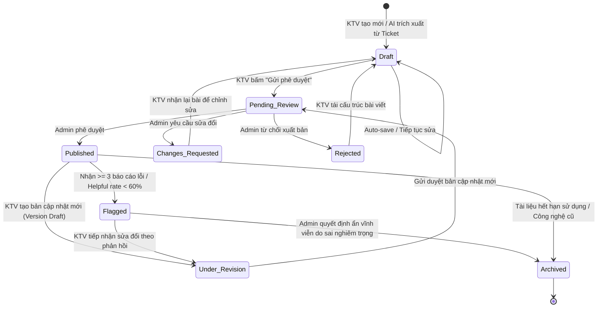
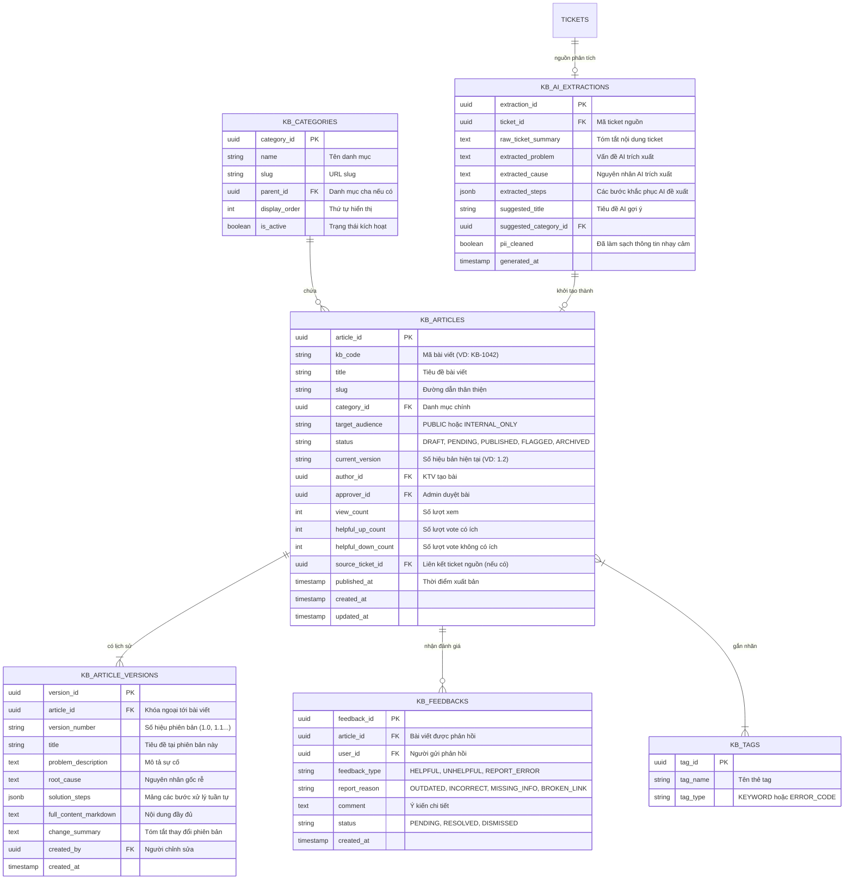

# 04. KIẾN TRÚC THÔNG TIN (INFORMATION ARCHITECTURE - IA)
> **Phân hệ:** Kho kiến thức — KB (Knowledge Base)  
> **Dự án:** Hệ thống Phân luồng & Xử lý Ticket tự động ứng dụng AI  
> **Nội dung:** Cấu trúc thông tin, Sơ đồ điều hướng, Vòng đời dữ liệu, ERD & Data Schema

---

## 1. Sơ đồ Kiến trúc Thông tin & Điều hướng (IA Map)

```text
CỔNG KHO KIẾN THỨC (KNOWLEDGE BASE PORTAL)
│
├── 1.0 TRANG CHỦ TRA CỨU (PUBLIC / AUTHENTICATED)
│   ├── 1.1 Khung tìm kiếm thông minh (AI Semantic Search + Auto-suggest)
│   ├── 1.2 Danh mục sự cố phân cấp (Hierarchical Categories)
│   │   ├── Phần cứng & Thiết bị ngoại vi (Hardware & Peripherals)
│   │   ├── Phần mềm văn phòng & Ứng dụng (Software & Tools)
│   │   ├── Mạng nội bộ, Wifi & VPN (Network & Connectivity)
│   │   └── Tài khoản, Email & Phân quyền (Account, IAM & Email)
│   ├── 1.3 Nhóm bài viết nổi bật (Pinned / Trending Articles)
│   ├── 1.4 Giải pháp xem nhiều nhất (Most Viewed)
│   └── 1.5 Lối tắt hỗ trợ: "Chưa tìm thấy giải pháp? [Tạo Ticket hỗ trợ]"
│
├── 2.0 TRANG CHI TIẾT BÀI VIẾT (ARTICLE VIEW)
│   ├── 2.1 Breadcrumb điều hướng (Trang chủ > Danh mục > Tên bài)
│   ├── 2.2 Header bài viết (Tiêu đề, Mã KB, Ngày cập nhật, Tác giả, Phiên bản)
│   ├── 2.3 Nhãn đối tượng xem (Badge: Public / Nội bộ IT)
│   ├── 2.4 Nội dung giải pháp cấu trúc chuẩn:
│   │   ├── 2.4.1 Tổng quan & Hiện tượng sự cố
│   │   ├── 2.4.2 Nguyên nhân gốc rễ (Root Cause)
│   │   ├── 2.4.3 Các bước xử lý tuần tự (Step-by-step) kèm Ảnh/Video/Code
│   │   └── 2.4.4 Tệp đính kèm tải về (Driver, Script fix lỗi, Mẫu cấu hình)
│   ├── 2.5 Danh sách Thẻ từ khóa (Tags) & Bài viết liên quan
│   └── 2.6 Khung đánh giá & Báo cáo chất lượng (Helpful thumbs & Feedback form)
│
├── 3.0 KHÔNG GIAN TÁC GIẢ KỸ THUẬT VIÊN (TECHNICIAN AUTHORING CONSOLE)
│   ├── 3.1 Danh sách bài viết của tôi (Tab: Nháp, Chờ duyệt, Đã duyệt, Bị từ chối)
│   ├── 3.2 Hộp thư AI Gợi ý (Danh sách Ticket Resolved tiềm năng biến thành KB)
│   └── 3.3 Trình soạn thảo bài viết (Editor Workspace)
│       ├── Form Metadata: Tiêu đề, Danh mục, Tags, Quyền truy cập
│       ├── Rich Text / Markdown Editor Toolbar
│       ├── Tải lên minh chứng / File đính kèm
│       └── Nút hành động: [Lưu nháp] [Xem trước] [Gửi phê duyệt]
│
└── 4.0 KHÔNG GIAN QUẢN TRỊ & KIỂM DUYỆT (ADMIN / LEAD CONSOLE)
    ├── 4.1 Hàng đợi phê duyệt (Review Queue) kèm chế độ so sánh phiên bản (Diff View)
    ├── 4.2 Hàng đợi xử lý bài viết bị báo cáo lỗi (Flagged Articles Queue)
    ├── 4.3 Quản lý Danh mục (Thêm/Sửa/Xóa Chuyên mục, sắp xếp thứ tự)
    └── 4.4 Dashboard đo lường hiệu quả KB:
        ├── Tổng số bài viết theo danh mục
        ├── Tỷ lệ đánh giá hữu ích (Helpful Rate %)
        └── Tỷ lệ giải quyết sự cố tự phục vụ (Self-Service Deflection Rate)
```

---

## 2. Vòng đời trạng thái bài viết (State Transition Diagram)



---

## 3. Mô hình Dữ liệu quan hệ (Entity Relationship Diagram - ERD)



---

## 4. Bảng từ điển dữ liệu chi tiết (Data Dictionary)

### Bảng 1: `kb_articles` (Lưu thông tin định danh và chỉ số bài viết)
| Cột | Kiểu dữ liệu | Ràng buộc | Ý nghĩa nghiệp vụ |
| :--- | :--- | :--- | :--- |
| `article_id` | UUID | PK, NOT NULL | Mã định danh duy nhất của bài viết |
| `kb_code` | VARCHAR(20) | UNIQUE, NOT NULL | Mã hiển thị thân thiện (Ví dụ: KB-1001, KB-1002) |
| `title` | VARCHAR(255) | NOT NULL | Tiêu đề chính của bài viết hướng dẫn |
| `slug` | VARCHAR(255) | UNIQUE, NOT NULL | Chuỗi URL thân thiện phục vụ tra cứu SEO/Web |
| `category_id` | UUID | FK, NOT NULL | Liên kết tới bảng danh mục `kb_categories` |
| `target_audience` | ENUM | NOT NULL, DEFAULT 'PUBLIC' | `PUBLIC` (mọi người xem được), `INTERNAL_ONLY` (chỉ KTV/IT) |
| `status` | ENUM | NOT NULL, DEFAULT 'DRAFT' | `DRAFT`, `PENDING_REVIEW`, `PUBLISHED`, `FLAGGED`, `ARCHIVED` |
| `current_version` | VARCHAR(10) | NOT NULL, DEFAULT '1.0' | Phiên bản đang được hiển thị công khai |
| `author_id` | UUID | FK, NOT NULL | ID của KTV khởi tạo bài viết |
| `approver_id` | UUID | FK, NULLABLE | ID của Admin/Lead duyệt bài xuất bản |
| `source_ticket_id`| UUID | FK, NULLABLE | ID ticket khởi nguồn (nếu bài do AI trích xuất) |
| `view_count` | INT | DEFAULT 0 | Tổng số lượt truy cập đọc bài |
| `helpful_up_count`| INT | DEFAULT 0 | Tổng số lượt bấm Thumbs Up (Hữu ích) |
| `helpful_down_count`| INT | DEFAULT 0 | Tổng số lượt bấm Thumbs Down (Không hữu ích) |
| `published_at` | TIMESTAMP | NULLABLE | Thời điểm bài viết được duyệt xuất bản lần đầu/mới nhất |

---

### Bảng 2: `kb_feedbacks` (Quản lý đánh giá và báo cáo chất lượng tài liệu)
| Cột | Kiểu dữ liệu | Ràng buộc | Ý nghĩa nghiệp vụ |
| :--- | :--- | :--- | :--- |
| `feedback_id` | UUID | PK, NOT NULL | Mã định danh bản ghi phản hồi |
| `article_id` | UUID | FK, NOT NULL | Bài viết KB nhận phản hồi |
| `user_id` | UUID | FK, NULLABLE | Người gửi (có thể ẩn danh nếu là khách) |
| `feedback_type` | ENUM | NOT NULL | `HELPFUL` (Thích), `UNHELPFUL` (Không thích), `REPORT_ERROR` (Báo lỗi) |
| `report_reason` | ENUM | NULLABLE | Lý do: `OUTDATED`, `INCORRECT_STEPS`, `MISSING_CONTEXT`, `BROKEN_LINK` |
| `comment` | TEXT | NULLABLE | Nội dung góp ý hoặc mô tả lỗi chi tiết từ người đọc |
| `status` | ENUM | DEFAULT 'PENDING' | Trạng thái xử lý: `PENDING` (Chờ xử lý), `RESOLVED` (Đã sửa), `DISMISSED` (Bỏ qua) |
| `created_at` | TIMESTAMP | DEFAULT NOW() | Thời điểm gửi phản hồi |

---

## 5. Luồng di chuyển dữ liệu (Data Flow) - Ticket Resolved đến KB xuất bản

```text
+-------------------+      KTV bấm nút      +--------------------+
|  TICKET RESOLVED  | --------------------> | AI EXTRACTION SVC  |
|  (Đã đóng lỗi)    |                       | (Trích xuất & PII) |
+-------------------+                       +--------------------+
                                                      |
                                                      | Sinh bản nháp chuẩn hóa
                                                      v
+-------------------+   KTV rà soát/sửa     +--------------------+
| PENDING REVIEW    | <-------------------- |   DRAFT KB FORM    |
| (Chờ Admin duyệt) |                       | (Trình soạn thảo)  |
+-------------------+                       +--------------------+
         |
         | Admin kiểm tra qua Diff View & Bấm Duyệt
         v
+-------------------+  Embeddings Vector   +--------------------+
|   PUBLISHED KB    | -------------------> | VECTOR SEARCH / DB |
| (Xuất bản công bố)|                      | (Tra cứu ngữ nghĩa)|
+-------------------+                      +--------------------+
         |                                            |
         | Người dùng đọc & Tra cứu                   | AI gợi ý khi tạo ticket
         v                                            v
+-------------------+                      +--------------------+
| USER TỰ XỬ LÝ LỖI | <------------------- | TICKET DEFLECTION  |
| (Self-Service)    |                      | (Giảm tải tổng đài)|
+-------------------+                      +--------------------+
```
